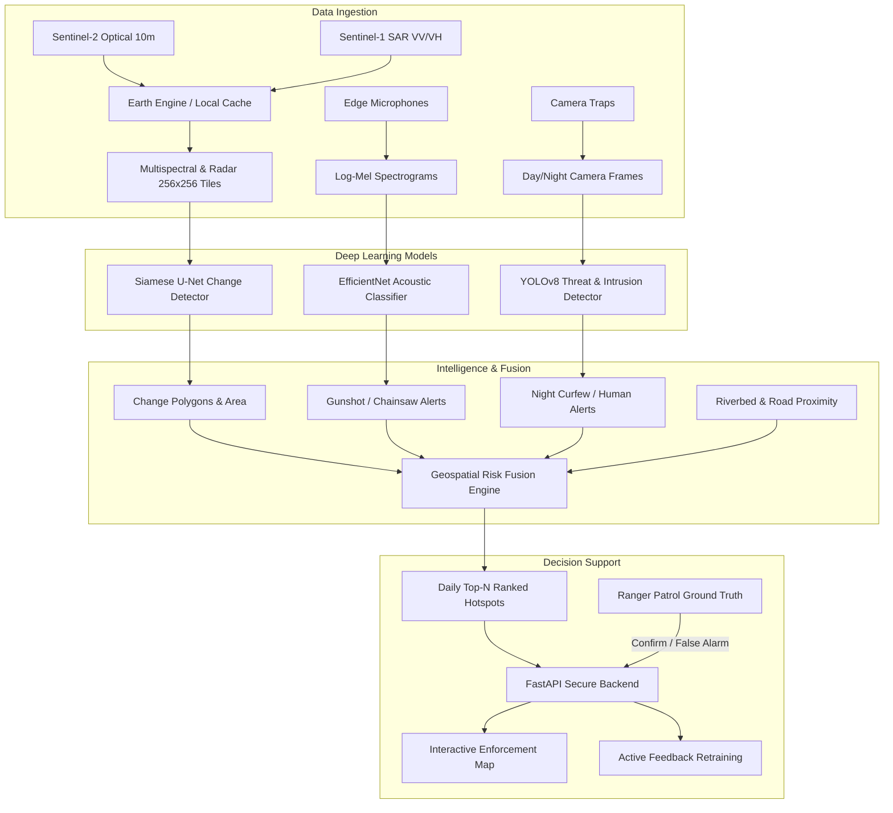

# Forest & River Guardian

[](https://www.python.org/downloads/)
[](https://opensource.org/licenses/MIT)
[](https://github.com/astral-sh/ruff)

> An end-to-end AI monitoring and early warning system designed for forest rangers and environmental enforcement teams. It fuses multi-temporal satellite change detection (Sentinel-2 optical & Sentinel-1 radar), edge acoustic sensors (gunshots & chainsaws), and camera-trap computer vision (unauthorized vehicles & humans) to deliver a daily, ranked, explainable patrol inspection map.

---

## Architecture Overview



---

## Key Features

1. **Multi-Sensor Satellite Change Detection**: Deep Siamese U-Net tracking fresh river sand extraction, clearings, and unpaved logging roads. Integrated with temporal seasonal suppression filters to reject natural phenology and agricultural cycles.
2. **Real-Time Acoustic Event Classification**: Fine-tuned convolutional classifier detecting gunshots, chainsaws, and heavy extraction engines with noise-robust SpecAugment at SNR down to -5 dB.
3. **Camera-Trap Intrusion Engine**: YOLOv8 detection of humans, vehicles, wildlife, and poaching snares with night/infrared rules triggering curfew alerts.
4. **Transparent Risk Fusion & Explainable Hotspots**: 500m hexagonal/square grid computing multi-criteria threat risk and generating plain-text field patrol rationales.
5. **Secure Enforcement Dashboard**: MapLibre/Leaflet interface with JWT role-based access control, strict wildlife coordinate privacy, and one-click ranger field feedback loops.

---

## Quickstart & Installation

### 1. Prerequisites
- Python 3.11
- `uv` (recommended) or standard `pip`
- Git

### 2. Environment Setup
```bash
# Clone the repository
git clone https://github.com/organization/forest-river-guardian.git
cd forest-river-guardian

# Create virtual environment with Python 3.11
uv venv .venv --python 3.11

# Activate environment
# On Linux/macOS:
source .venv/bin/activate
# On Windows PowerShell:
.\.venv\Scripts\Activate.ps1

# Install pinned dependencies
uv pip install -r requirements.txt
```

### 3. Configuration
Copy `.env.example` to `.env`:
```bash
cp .env.example .env
```
Adjust `configs/region.yaml` for your monitoring bounding box and river corridor.

### 4. Run Tests & Linting
```bash
ruff check .
pytest -v
```

---

## Project Structure
```
forest-river-guardian/
├── configs/             # Region, training, and risk fusion YAML configurations
├── data/                # Raw, processed, labels, and offline sample data
├── frontend/            # Interactive MapLibre/Leaflet dashboard
├── notebooks/           # Exploratory and evaluation Jupyter notebooks
├── reports/             # Evaluation metrics, confusion matrices, final report
├── scripts/             # End-to-end automation scripts
├── src/
│   ├── api/             # FastAPI backend with JWT auth & SQLite DB
│   ├── data/            # Earth Engine, tiling, labeling, audio & camera data
│   ├── infer/           # Batch and streaming inference pipelines
│   ├── models/          # Siamese U-Net, Audio classifier, YOLO detector
│   ├── risk/            # 500m grid generator, risk fusion, ranking engine
│   └── train/           # Training scripts with MLflow tracking
└── tests/               # Comprehensive pytest test suite
```

---

## Privacy & Safety Notice
Location coordinates for endangered fauna and wildlife sightings are cryptographically protected and strictly hidden from unauthenticated or public views. All alert data is restricted to authorized forest service and mining vigilance personnel.
