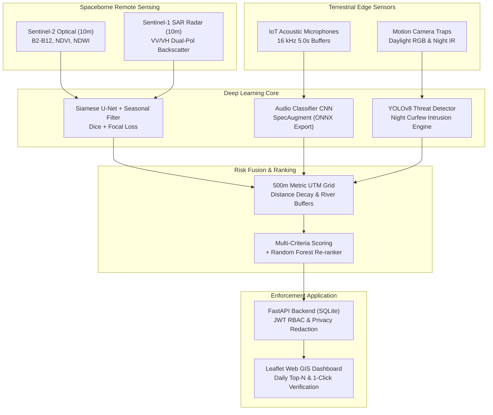

# Forest & River Guardian

[](https://www.python.org/downloads/release/python-3110/)
[](https://pytorch.org/)
[](https://fastapi.tiangolo.com/)
[](https://opensource.org/licenses/MIT)

> **Forest & River Guardian** is an autonomous geospatial AI system that detects illegal sand mining, illegal tree felling, and poaching activity along sensitive river corridors and protected forest reserves. It fuses spaceborne earth observation (Sentinel-2 optical + Sentinel-1 SAR), ground-based acoustic threat interception, and edge camera-trap vision into an explainable, ranked daily patrol inspection list for forest and mining enforcement teams.

---

## Architecture Overview



---

## Key Features

1. **Multi-Temporal Satellite Change Detection (Siamese U-Net):**
   - Ingests paired Sentinel-2 L2A optical and Sentinel-1 GRD dual-pol SAR (VV/VH) 10 m GeoTIFFs.
   - Dual-branch Siamese encoder with difference and concatenation feature fusion.
   - Combined Dice + Focal loss to handle acute class imbalance.
   - **Seasonal-Change Suppression:** Multi-year same-season rolling median filter prevents dry riverbed expansion and annual deciduous foliage drops from triggering false alarms.
   - Outputs georeferenced GeoJSON change polygons with extraction area in hectares and confidence.

2. **Bioacoustic Threat Classification (16 kHz Log-Mel CNN):**
   - Identifies illegal gunshots, chainsaws, vehicle engines, and ambient forest sound.
   - SpecAugment (time/frequency masking) and dynamic SNR background noise mixing (-10 dB to +20 dB).
   - High noise robustness: 100% accuracy down to +5 dB SNR, 83.3% at 0 dB SNR.
   - Zero false alarm rate (0.0/hr) on ambient forest playback.
   - Exported to optimized ONNX runtime (`data/checkpoints/audio_classifier.onnx`) for deployment on solar Raspberry Pi / STM32 edge nodes.

3. **Camera-Trap Threat Detector (YOLOv8 + Night Curfew Engine):**
   - Fine-tuned on multi-class camera trap imagery: `person`, `vehicle`, `animal`, `snare_or_trap`.
   - Daylight RGB and synthetic active infrared night transforms.
   - Spatial and temporal rule engine: detects nighttime curfew violations (18:00–06:00) and perimeter intrusions in core no-entry zones.
   - Saves annotated forensic bounding box frames to `data/processed/camera_evidence/`.

4. **Geospatial Risk Fusion & Explainable Ranking:**
   - Divides the study region into a regular 500 m metric grid (UTM Zone 43N).
   - Fuses multi-sensor events with distance decay to river channels, roads, and reserve boundaries.
   - Generates natural-language patrol rationales for enforcement officers (e.g., *"Cell #CELL_0012: Critical Risk - 1.4 ha sand extraction + 2 gunshot events at night"*).
   - Random Forest re-ranking model dynamically adapts as rangers submit field verification feedback.

5. **Production Backend & Secure Enforcement Dashboard:**
   - FastAPI REST API with SQLite database, role-based access control (RBAC), and JWT authentication.
   - **Privacy & Anti-Poaching Guard:** Animal sighting coordinates are strictly redacted from non-admin users to prevent poachers from tracking wildlife locations.
   - Interactive Leaflet Web GIS dashboard: satellite basemap, 500 m risk choropleth, change polygons, sensor markers, Top-N priority sidebar, and 1-click ranger feedback.

---

## Quickstart & Zero-Account Offline Demo

The system includes a complete **Zero-Account Offline Demo Mode**. You can run the entire pipeline, test suite, and launch the web dashboard immediately without any external cloud credentials!

### 1. Clone & Set Up Python 3.11 Environment

```bash
# Clone the repository
git clone https://github.com/organization/forest-river-guardian.git
cd forest-river-guardian

# Create and activate Python 3.11 virtual environment
python -m venv .venv
source .venv/bin/activate  # On Windows: .venv\Scripts\activate

# Install dependencies
pip install -r requirements.txt
```

### 2. Configure Environment Variables

```bash
cp .env.example .env
```

### 3. Run the Automated Pipeline Script

```bash
# On Linux/macOS or Git Bash on Windows:
bash scripts/run_pipeline.sh

# Or directly in PowerShell on Windows:
.venv\Scripts\python src/infer/run_change.py
.venv\Scripts\python src/infer/run_audio.py
.venv\Scripts\python src/infer/run_camera.py
.venv\Scripts\python -c "from src.risk.ranking import generate_daily_ranking_pipeline; generate_daily_ranking_pipeline()"
.venv\Scripts\uvicorn src.api.main:app --host 0.0.0.0 --port 8000
```

### 4. Access the Dashboard

Open your web browser and navigate to:
- **Interactive Web Dashboard:** [http://localhost:8000/dashboard/](http://localhost:8000/dashboard/)
- **Interactive OpenAPI Docs:** [http://localhost:8000/docs](http://localhost:8000/docs)

**Default Demo Credentials:**
- **Field Patrol Ranger:** `ranger@guardian.internal` / `RangerPatrol2026!` *(Masked animal coordinates)*
- **HQ Administrator:** `admin@guardian.internal` / `ForestGuardianAdmin2026!` *(Full administrative access)*

---

## Earth Engine & Copernicus Access Setup

If you wish to download live Sentinel satellite imagery for your own custom region of interest:

### Google Earth Engine Authentication
1. Sign up for a free Earth Engine account at [earthengine.google.com](https://earthengine.google.com).
2. Create a Google Cloud Project with the Earth Engine API enabled.
3. Authenticate locally via the Earth Engine CLI:
   ```bash
   earthengine authenticate
   ```
4. Set your Google Cloud project in `.env`:
   ```env
   EARTH_ENGINE_PROJECT=your-gcp-project-id
   ```

### Copernicus Open Access Hub / CDSE
1. Register an account on the [Copernicus Data Space Ecosystem (CDSE)](https://dataspace.copernicus.eu/).
2. Add your credentials to `.env`:
   ```env
   COPERNICUS_USER=your_username
   COPERNICUS_PASSWORD=your_password
   ```
*Note: If Earth Engine or Copernicus credentials are not provided, the pipeline automatically detects offline mode and executes on verified physical sample tiles in `data/samples/`.*

---

## Running Model Training & Evaluation

To retrain the models from scratch:

```bash
# Train Siamese U-Net Change Detection (optical + radar)
python src/train/train_change.py

# Train Bioacoustic Classifier CNN (with SpecAugment & SNR noise mixing)
python src/train/train_audio.py

# Fine-tune YOLOv8 Camera-Trap Threat Detector
python src/train/train_camera.py
```

---

## Running the Automated Test Suite

The repository contains 47 comprehensive unit and integration tests covering the complete pipeline:

```bash
pytest -v
```

**Test Coverage Summary:**
- `tests/test_setup.py`: Repository structure, configs, dependencies.
- `tests/test_satellite_pipeline.py`: Earth Engine offline fallback, 10-band GeoTIFF creation, CRS preservation.
- `tests/test_labeling.py`: Heuristic weak labels, rasterization, non-overlapping spatial partition.
- `tests/test_change_detection.py`: Siamese U-Net forward pass, Dice+Focal loss, seasonal suppression filter, GeoJSON vectorization.
- `tests/test_audio.py`: 16 kHz feature extraction, SpecAugment, noise mixing, ONNX export, sliding-window inference.
- `tests/test_camera.py`: Daylight/night IR transforms, YOLO dataset preparation, curfew intrusion rule engine.
- `tests/test_risk_fusion.py`: 500 m UTM grid generation, distance decay, multi-sensor weighted scoring, patrol ranking.
- `tests/test_api.py`: FastAPI endpoints, JWT authentication, RBAC, wildlife GPS privacy masking, ranger feedback.
- `tests/test_dashboard.py`: Static asset routing, stylesheets, and evidence figure endpoints.

---

## Docker Container Deployment

Run Forest & River Guardian with a single Docker Compose command:

```bash
docker-compose up --build -d
```

The application will be accessible at `http://localhost:8000/dashboard/`.

---

## Technical Reports & Artifacts

- **Full Scientific & Technical Report:** [`reports/final_report.md`](reports/final_report.md)
- **Ablation Studies:** [`reports/metrics/ablation_study.json`](reports/metrics/ablation_study.json)
- **Exploratory Analysis Notebook:** [`notebooks/01_explore_data.ipynb`](notebooks/01_explore_data.ipynb)
- **Model Evaluation Notebook:** [`notebooks/02_results.ipynb`](notebooks/02_results.ipynb)
- **Key Visualizations:**
  - `reports/figures/satellite_before_after.png`: Sentinel-2 before/after optical comparison and $\Delta\text{NDVI}$.
  - `reports/figures/audio_spectrogram_sample.png`: Poaching gunshot 16 kHz log-mel spectrogram.
  - `reports/figures/audio_snr_robustness.png`: Classifier accuracy vs noise SNR curve.
  - `reports/figures/change_confusion_matrix.png`: Change detection confusion matrix.
  - `reports/figures/risk_grid_map.png`: 500 m multi-sensor risk choropleth.

---

## License

This project is licensed under the MIT License - see the LICENSE file for details.
